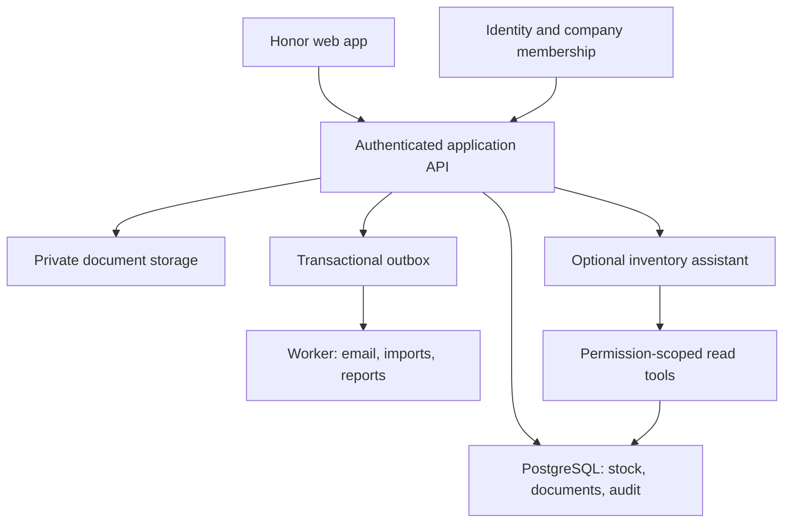

# Honor Inventory — implementation blueprint

Date: 23 October 2026. Status: wider product blueprint. A first connected backend, staff workspace and customer storefront are implemented locally; production resources are not provisioned. See DELIVERY_STATUS.md for verified scope and remaining work.

Online deployment is now the selected direction. The [online stack plan](STACK_PLAN.md) defines the recommended technologies, public storefront, payment workflow and first demand-forecasting module. It supersedes the earlier tentative Node API recommendation; the current frontend implementation remains a demo.

## 1. Product decision

Honor's main job is inventory control. A company should be able to answer: what do we own, where is it, what is available, what moved, who changed it, and what needs replenishing?

Start with the Store product's phone/electronics workflows: individually tracked devices by IMEI/serial, quantity-based accessories, multiple stock locations and named staff. Preserve a general item/variant model so other durable-goods retailers can be evaluated later.

CRM supports inventory through customer/device ownership, warranty and returns. Sales supports inventory through reservation and stock issue. ERP supports inventory through purchasing, supplier receipts, approvals and valuation. Full accounting, payroll, marketing automation and a separate general CRM sales pipeline are outside the first release.

Success criteria: no unexplained stock change; one device cannot be sold twice; movements reconcile to balances; every branch sees the same committed data; staff see only permitted company/location data; actionable low-stock information is available within a few clicks.

## 2. Lessons from comparable products

These are design lessons from official documentation, not a claim that Honor has their implementation, scale or certifications.

| Reference                                                                                                                                                        | Documented pattern                                                                         | Decision for Honor                                                                                            |
| ---------------------------------------------------------------------------------------------------------------------------------------------------------------- | ------------------------------------------------------------------------------------------ | ------------------------------------------------------------------------------------------------------------- |
| [Zoho serial tracking](https://www.zoho.com/au/inventory/help/advanced-inventory-tracking/serial-number-tracking.html)                                           | Individual units are tracked through receipt and sale, supporting warranty/service lookup. | Make serial/IMEI a first-class unit record linked to movement history and customer sale.                      |
| [Zoho transaction approvals](https://www.zoho.com/in/inventory/help/transaction-approval-new-flow/)                                                              | Dedicated transaction approval workflows and approver roles.                               | Let company admins define thresholds and approvers; track requester, reviewer, decision and reason.           |
| [Odoo reordering rules](https://www.odoo.com/documentation/20.0/applications/inventory_and_mrp/inventory/warehouses_storage/replenishment/reordering_rules.html) | Replenishment rules help maintain minimum stock levels.                                    | Start with deterministic min/max rules by item and location; show a suggested purchase or transfer.           |
| [ERPNext permissions](https://docs.frappe.io/erpnext/permissions)                                                                                                | Permissions combine roles, document types, stages and user restrictions.                   | Authorise actions and location scope on the server, including submit, approve, dispatch, receive and reverse. |
| [ERPNext immutable ledger](https://docs.frappe.io/erpnext/immutable-ledger-in-erpnext)                                                                           | Corrections preserve evidence through reversals and controlled workflows.                  | Posted movements are append-only; correct through linked reversals rather than editing the past.              |

Borrow these patterns. Do not reproduce the breadth or crowded menus of a general ERP.

## 3. Navigation and dashboard

Primary navigation: Inventory overview; Inventory; Receive stock; Purchase orders; Transfers; Movement history. Supporting navigation: Sales, Customers, Suppliers, Reports. Company navigation: People & access, Locations, Settings and Audit trail.

Dashboard: four clear metrics (available units, item/location pairs needing replenishment, incoming transfer units, authorised stock value); a stock-health table with search and attention/all views; a short operations panel; recent movements. Financial reports and a full product catalogue belong in their own screens. Keep company and location context visible. Treat available = on hand minus reserved; in-transit stock must not appear available at either end.

Use the existing emerald/dark-sidebar design, restrained borders, consistent 16–24px inner padding, generous separation between sections, legible 13–14px working text, and controls with clear keyboard focus. On phones, prioritise stock lookup, receiving and movement history; move secondary controls into the menu. Test at 360px, 768px and desktop widths, with keyboard use and 200% zoom.

## 4. Core workflows and state rules

| Workflow             | Stages                                                                                        | Required invariant                                                                                                             |
| -------------------- | --------------------------------------------------------------------------------------------- | ------------------------------------------------------------------------------------------------------------------------------ |
| Company setup        | Verified admin → company → locations → staff invitations → catalogue → reviewed opening stock | A signed-in user cannot choose their own privileged role or join an arbitrary company.                                         |
| Purchase and receipt | Draft PO → approved → ordered → partially received → received                                 | Receipt quantity cannot exceed the remaining order without an explicit, separately authorised variance.                        |
| Sale / stock issue   | Draft → reserve → confirm issue → receipt                                                     | Recheck availability at commit; a device belongs to one successful sale. Expired/cancelled reservations release stock.         |
| Transfer             | Draft → approved → dispatched → partially received / discrepancy → received                   | Dispatch reduces source availability; receipt posts only physically accepted units; shortages stay visible in transit/dispute. |
| Stock count          | Count session → counted quantities → variance → manager approval → posted adjustment          | A count is not an unrestricted overwrite. Preserve the count snapshot, intervening movements and reason.                       |
| Customer return      | Referenced sale line → inspection → approve → restock / quarantine → credit/refund record     | Never create a second device record for the returned IMEI; a line cannot be returned more than sold.                           |
| Correction           | Original posted document → authorised reversal → replacement if needed                        | Every reversal points to the original and nets the appropriate stock and payment effects.                                      |
| Replenishment        | Below minimum → suggested transfer/PO → review → approval                                     | Recommendations never silently place supplier orders.                                                                          |

The current demo supports complete transfer receipt and full-sale reversal. Partial/discrepancy transfer receiving, true line-level returns, stock-count sessions and persisted approval requests remain backend milestones. The old demo return path has been blocked because it could duplicate a serial unit.

## 5. Company administration

The customer company administers its own workspace. Separate the product operator from company administrators: hosting support access should be exceptional, temporary and audited, rather than a permanent ability to impersonate every company.

| Role                      | Stock access                                                    | Approvals                                                   | Administration                                                                           |
| ------------------------- | --------------------------------------------------------------- | ----------------------------------------------------------- | ---------------------------------------------------------------------------------------- |
| Company administrator     | All permitted company locations                                 | Company policy and delegated approvers                      | Invite/suspend staff; roles; location scope; business settings; exports and audit access |
| Branch manager            | Assigned locations                                              | Within assigned scope and thresholds                        | Cannot grant company-admin rights or alter another branch's scope                        |
| Stock operator            | Assigned receipts, transfers, counts and movements              | Requests adjustments; cannot approve own restricted changes | No staff or company settings                                                             |
| Sales staff               | Stock availability and own authorised sales/customer operations | Requests discounts/returns                                  | No costs, roles or settings                                                              |
| Read-only auditor (later) | Assigned reports and ledger                                     | None                                                        | No writes                                                                                |

Membership = company + user + active status + role. Location grants further restrict membership. Enforce tenant, action, location, field sensitivity and document state for every API, export, job and AI tool. Ignore client-supplied staff IDs and approver claims. Derive the actor from a verified session. Check suspension on subsequent requests; ensure the company retains an active administrator. Require fresh authentication for privileged role changes.

## 6. System design

Use one modular backend initially. Boundaries are Identity & Company, Catalogue, Inventory Ledger, Procurement, Sales/Returns, Contacts and Reporting. A distributed microservice architecture would add coordination overhead before it solves a demonstrated need.

Recommended stack: keep the React/Vite/TypeScript staff dashboard; add a Next.js customer storefront; use one Python FastAPI backend with SQLAlchemy/Alembic and PostgreSQL hosted on Supabase. Use Supabase Auth and Storage, Vercel for the web apps, and Render for the API, worker and scheduled jobs. Put API/database in compatible nearby regions. This is a proposed architecture, not an existing connection. See the [stack plan](STACK_PLAN.md) for boundaries, commercial-hosting considerations and implementation gates.

The browser never owns stock truth. A server command validates the session, membership and permissions, locks affected balances/serial units in a stable order, revalidates the document state and available quantities, appends ledger entries, updates the balance projection and audit/outbox, and commits once. Failure rolls back everything. Use unique command IDs and stored idempotency keys so retries do not repeat a receipt or sale. Retry deadlocks/serialization failures with a bounded policy. The same request key with a different payload is a conflict.

Use SQL transaction boundaries, row locks and conditional updates, not read-then-write JavaScript. See [PostgreSQL locking](https://www.postgresql.org/docs/18/explicit-locking.html). Never clamp an invalid negative balance to zero; reject the command and explain the conflict.

## 7. Data model

| Group                   | Tables and key relationships                                                                                    |
| ----------------------- | --------------------------------------------------------------------------------------------------------------- |
| Identity                | companies; users linked to identity provider; memberships; membership_locations; invitations; role_permissions  |
| Catalogue               | products; variants; serial_units; locations; reorder_rules                                                      |
| Inventory               | stock_documents; document_lines; stock_movements; stock_balances; reservations; count_sessions; count_lines     |
| Supporting transactions | suppliers; purchase_orders; purchase_lines; receipts; sales; sale_lines; payments; returns; return_lines        |
| Online commerce         | storefronts; product_publications; orders; order_lines; payment_attempts; provider_events; fulfilments; refunds |
| Forecasting             | demand_daily; model_versions; forecast_runs; demand_forecasts; replenishment_suggestions                        |
| Control                 | approval_requests; approval_decisions; audit_events; idempotency_keys; outbox_events; import_jobs               |

Every business table has company_id. Use composite tenant foreign keys so an item from company A cannot reference a location or sale from company B. Unique(company_id, serial/IMEI), Unique(company_id, SKU), Unique(company_id, variant_id, location_id), and Unique(company_id, command/idempotency key) are enforced in the database.

Use integer quantities for this initial device/accessory scope and reject fractions. Store money in integer minor units or fixed-precision decimal, with currency; avoid floating-point totals. Store UTC timestamps and apply company timezone when reporting. Product tracking type cannot change after movements without a controlled migration. Serial-unit cost comes from the actual receipt; quantity inventory needs an explicit valuation policy (e.g. weighted average or FIFO). The current demo's current-cost estimate is not an implemented FIFO ledger.

Keep posted movement rows immutable to application roles. Rebuild balances from ledger entries and compare the result in reconciliation checks. Store count/reservation/transfer state separately from the physical movement facts.

If Supabase is used, enforce RLS and minimum grants on exposed tables, keep service credentials only on the server, and test both allowed and denied membership cases: [RLS documentation](https://supabase.com/docs/guides/database/postgres/row-level-security).

## 8. APIs and connections

| Connection                             | Purpose                                                                          | When                                                                          |
| -------------------------------------- | -------------------------------------------------------------------------------- | ----------------------------------------------------------------------------- |
| Internal inventory API                 | Catalogue, balances, receipts, transfers, counts, reservations, audit, approvals | Required for connected operation                                              |
| PostgreSQL                             | Shared authoritative records and transactions                                    | Required                                                                      |
| Identity provider (e.g. Supabase Auth) | Sign-in, recovery, MFA, verified invitations                                     | Required                                                                      |
| Transactional email / provider SMTP    | Staff invitations, password recovery, optional stock alerts                      | Required for email-based onboarding; configure sender domain                  |
| Private object storage                 | PO attachments, receipt evidence, CSV import files                               | Required when attachments/imports ship                                        |
| Background worker / scheduler          | Outbox delivery, large imports/exports, reconciliation and alerts                | Add at the backend milestone; a Postgres-backed outbox can start small        |
| Error tracking and operational logs    | Diagnose failed commands, monitor stock posting failures                         | Before live pilot                                                             |
| Hosted payment provider                | Customer checkout, verified payment events, refunds and reconciliation           | Required for online purchases; choose after merchant eligibility is confirmed |
| Python forecasting job                 | Evaluated demand forecasts and reviewed replenishment suggestions                | After reliable historical sales and availability data exist                   |
| Ollama or compatible model endpoint    | Optional inventory questions and summaries                                       | After authorised, accurate reads work                                         |
| Accounting / commerce connectors       | Synchronise existing systems through signed, idempotent webhooks                 | Only for a validated company requirement                                      |

Barcode scanners commonly type into focused inputs; a paid barcode API is not necessary for basic scanning. Device-camera scanning requires permission and a tested scanning library. External IMEI lookup remains optional. Payment processing is required for the chosen online purchase workflow: use hosted checkout, verified and deduplicated provider events, stock reservations and separate payment/fulfilment states as specified in the [stack plan](STACK_PLAN.md).

Configuration names: DATABASE*URL, AUTH_URL, AUTH_ISSUER, AUTH_AUDIENCE, AUTH_JWKS_URL, STORAGE_BUCKET, EMAIL_PROVIDER_API_KEY, EMAIL_FROM, APP_ORIGIN, LLM_BASE_URL, LLM_MODEL, LLM_API_KEY. Only browser-safe public settings may use a VITE* prefix. Use per-environment secrets; company name, receipt text, currency, timezone, tax setup and approval thresholds live in company settings.

## 9. Open-source model

The first predictive ML module is demand forecasting and reviewed replenishment suggestions. Run it as a scheduled Python job against validated sales/availability history; evaluate against a simple baseline using chronological tests. The language-model assistant below is a later, separate capability. See the [stack plan](STACK_PLAN.md) for the data requirements and release gate.

Keep the model replaceable. Evaluate candidates against the actual licence, business deployment rights, tool-call accuracy, latency, memory requirements, cost and hardware before selecting a particular model. Open weights and open-source licensing are not interchangeable.

The first assistant answers inventory questions with server tools: get_stock_balance, list_low_stock, trace_serial_history, list_incoming_transfers and summarise_movements. It retrieves numeric facts from the same permission-scoped API and returns references, location and as-of time. Structured tables do not need a vector database initially. Documentation Q&A can use retrieval later.

[Ollama supports tool calls for compatible models](https://ollama.com/blog/tool-support); the application still validates and authorises every tool execution. The model gets neither database credentials nor unrestricted SQL. Begin with read-only tools; proposed adjustments or purchase orders become reviewable drafts using normal approvals. A model outage must not interrupt stock operations.

## 10. Delivery sequence

| Milestone                           | Concrete result                                                                                                                              | Acceptance                                                                                                                              |
| ----------------------------------- | -------------------------------------------------------------------------------------------------------------------------------------------- | --------------------------------------------------------------------------------------------------------------------------------------- |
| 1. Product foundation — this branch | Honor branding; calmer inventory dashboard; company-access demo; consistent frontend types and stock regression tests; blueprint             | Type check, tests and production build pass. Browser review recorded separately.                                                        |
| 2. Shared identity and stock truth  | Auth, company memberships, location grants, SQL schema, receipt/issue/transfer APIs, idempotency and ledger                                  | Two staff see the same committed stock. Concurrent sale of the last unit succeeds once. Cross-company/location API requests are denied. |
| 3. Customer purchase and operations | Public storefront, stock reservations, hosted checkout, verified payment processing and fulfilment; controlled returns, counts and approvals | Sandbox purchase completes; duplicate/late payments and expired reservations are safe; operational ledger and balances reconcile.       |
| 4. Company pilot                    | Real business settings, migration/import, exports, email, private attachments, backups and monitoring                                        | Reviewed opening stock; recovery drill; real users complete receipt → sale → fulfil → return/count workflows on desktop and phone.      |
| 5. Demand forecasting               | Historical sales/availability pipeline, evaluated baseline and candidate, stored forecasts and replenishment suggestions                     | Chronological evaluation and documented limitations; a candidate ships only when it provides useful value over the baseline.            |
| 6. Optional inventory assistant     | Selected open-source model with scoped read tools and measurable question quality                                                            | Answers match ledger-backed reports, cite records and respect cost/location restrictions; failure leaves inventory usable.              |

No calendar estimate is a promise without company scale, integration scope and infrastructure budget. Start with one company, then prove tenant isolation before onboarding more.

## 11. Release and operations

Use isolated development, preview and production environments with separate databases and secrets. CI runs type check, stock/permission tests and build. Backend CI adds migrations, API contract tests, RLS denied cases, command replay and concurrency tests. Preview uses fictional fixtures only.

Log command ID, company, actor, action, timings and outcome without tokens, full personal details or secrets. Alert on failed postings, reconciliation differences, duplicate serials and stuck transfers/outbox jobs. Define backup retention, recovery-point and recovery-time targets with the company; test restore before live launch. Use an expand/migrate/contract strategy for schema changes so code rollback does not corrupt the ledger.

## 12. Decisions still needed before a live pilot

Company identity and registration country; payment-provider eligibility and settlement currency; deployment region; locations and user count; actual serial/quantity mix; stock valuation policy; adjustment and purchase approval limits; whether a manager can approve their own requests; existing import format; any required POS/accounting integration; shipping/collection rules; historical sales data; and hosting/model budget. Online confirmation is selected for the first release. Offline stock writes would need a separate allocation and conflict design.
