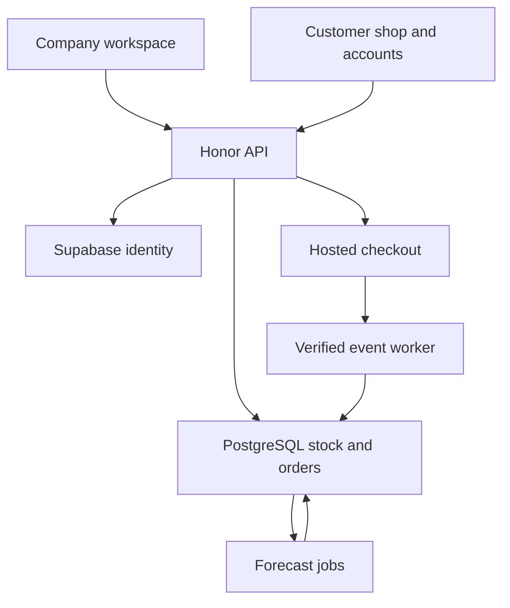

# Honor: product and launch plan

Working plan, 23 October 2026. Items marked planned are not live features.

## 1. The problem and the first customer

Honor helps a business know which products it has, where they are, what is reserved, what has sold and what needs replenishing. The company controls who can see or change those records. Its customer shop sells against the same stock records.

The initial pilot assumption is a retailer with a shop and a stockroom or multiple branches. The existing phone/electronics workflow is a useful starting point because it exercises both serial-number tracking and quantity stock. Confirm the actual pilot business before tailoring tax, receipts, delivery or valuation.

The first product has two connected areas: the company's workspace and its customer shop. The company owns its catalogue, prices, staff access and fulfilment. Customers browse, buy and view their own orders. A global multi-seller marketplace is a later product decision: seller verification, settlements, disputes, fraud operations and cross-border delivery would materially expand the work.

Success is measured by stock accuracy, prevented overselling, time to receive/locate stock, order completion and replenishment decisions. A working chatbot alone does not establish product value.

## 2. What is online now

Public product preview: https://honor-inventory-preview.zippyduck7.chatgpt.site

This deployment is a static demonstration. Every visitor sees fictional records and keeps changes in that browser. It accepts no real payments and provides no shared company stock or real customer account centre. The preview flag bypasses connected login deliberately; it must stay false in the production workspace.

Application source: `NIDHOGGR-shadow/honor-erp`, branch `feat/online-inventory`, draft PR #1. The connected backend and Next.js shop have passed CI builds and tests but still need their production services and hosted acceptance tests. Preview code and connected business operations must not be confused in sales material.

Vercel project creation returned a permission error, and Render could not fetch the new private repository through its current connection. Sites hosts the public preview. Resolve those account/repository permissions when provisioning the connected release. Do not make the source repository public to fix a hosting connection.

## 3. Lessons from comparable products

These are product-design conclusions from official sources, not claims that Honor already matches these products.

| Reference | Observed pattern | Decision for Honor |
| --- | --- | --- |
| Zoho Inventory [1, 2] | Stock control connects items, orders, locations and reorder alerts. | Keep stock as the core. Replenishment starts with understandable thresholds and supplier lead times. |
| Shopify customer accounts [3, 4] | Accounts provide profiles, order history and order status; checkout can be configured to require sign-in. | Recommend optional accounts initially. Explain their benefit; do not require registration merely to collect payment. |
| Amazon conversational shopping [5] | Product discovery, comparisons and recommendations use catalogue information and shopping context. | Begin with questions about actual published products, supported facts, current prices and availability. |
| Supabase Google sign-in [6] | Google login requires an OAuth client and correctly configured origins/callbacks. | Add a real, server-verified Google flow, with email sign-in as another route. A decorative Google button is not completion. |
| Stripe Checkout [7] | Hosted checkout and saved-payment capabilities are separate integration concerns. | Let an eligible payment provider handle payment entry. Add remembered payment methods later with explicit customer choice. |

## 4. Roles and boundaries

| Person | Intended control |
| --- | --- |
| Company administrator | Company setup, staff invitations, roles, location grants, suspension, forced sign-out and protected admin operations. |
| Manager | Catalogue/prices and permitted stock operations; no automatic authority to appoint company administrators. |
| Stock operator | Assigned-location receiving, movement and fulfilment permissions. |
| Sales staff | Assigned sales/order tasks; no staff administration or cost-price disclosure by default. |
| Customer | Public catalogue, own profile, own cart and own orders; no staff or private inventory access. |

Existing backend product creation and editing require ADMIN or MANAGER. The company sets selling prices. A customer submits product IDs and quantities; the server calculates the authoritative amount. Negotiated quotes, customer-specific price lists and automatic repricing are separate future features.

Customers can reset their own account access. Company administrators can suspend staff and initiate a managed reset; they should not learn or choose another person's password. Staff administration retains MFA and recent verification. A customer identity never becomes a staff membership because their email matches a company domain.

## 5. System design

Keep the existing React/Vite staff interface, Next.js shop, Python/FastAPI backend and PostgreSQL. This preserves the tested work and gives future forecasting a Python environment. PostgreSQL transactions own stock correctness; the browser and language model are not stock authorities.

The diagram includes planned customer accounts and forecasting. Company identity integration, stock/order transactions and payment-event processing already exist in source. The public preview uses none of these live services.

Deploy the staff interface and API on one origin initially. Proxy shop API calls through its own origin. Each surface uses secure HttpOnly sessions; do not assume cookies will work across unrelated hosting domains. Keep database, identity, email and payment credentials server-side. Use separate test and production resources.

| Connection | Current state | Next work |
| --- | --- | --- |
| React workspace to FastAPI | Implemented | Deploy together, verify company/location isolation in browsers. |
| FastAPI to PostgreSQL | Schema, migrations, transactions and tests implemented | Provision isolated database, restricted runtime role, backups and restore exercise. |
| Supabase Auth | Staff email/password, recovery and MFA integration implemented | Configure SMTP, allowed redirects and hosted acceptance; implement customer OAuth/account linking. |
| Next.js shop to catalogue/order API | Implemented | Configure backend origin and company slug; validate checkout from the hosted shop. |
| Payment provider to API/worker | Paystack/Stripe adapters implemented, disabled until configured | Select eligible pilot merchant, configure provider test mode and signed webhooks. |
| Email provider to outbox worker | Queue and delivery adapter implemented | Configure sender, verify invitations/recovery/order notices and failed-job alerts. |
| Forecast/model endpoint | Planned | Add isolated worker/model service only after its evaluation and operating budget are defined. |

Use the current transactional outbox and leased worker initially. A separate event-stream platform is unnecessary for the first pilot. Monitor request failures, queue age, failed payment jobs, stock reconciliation and backup health without logging secrets or raw card/contact payloads.

## 6. Customer account centre: next implementation slice

The customer centre should include email/Google sign-in, name/email, order history, order details, collection information, sign-out and recovery. Saved addresses become useful when shipping is implemented; collection is the current fulfilment method.

Planned data additions: a customer profile linked to the verified identity and company; a nullable buyer identity on orders; explicit claim records for guest-order linking; account/security event history. Do not reveal or attach guest orders merely because somebody types the same email address. Claiming an old order needs verified ownership, and another customer's order ID must never authorize access.

Proposed endpoints, not existing contracts:

| Endpoint | Purpose |
| --- | --- |
| `GET /api/v1/auth/google/start` | Start OAuth with server-owned state, PKCE and an allowed return destination. |
| `GET /api/v1/auth/google/callback` | Verify state, exchange code, verify provider identity and create an Honor session. |
| `GET/PATCH /api/v1/customer/profile` | Read/update the signed-in customer's permitted profile fields. |
| `GET /api/v1/customer/orders` | Paginated history scoped to the verified customer and store. |
| `GET /api/v1/customer/orders/{id}` | Authorized order detail, collection and payment/fulfilment status. |
| `POST /api/v1/customer/order-claims` | Verified, expiring claim flow for a guest order. |

Customers can use email sign-in or Google. Google client secrets stay with the managed identity service. Link accounts through verified provider identities and explicit reauthentication where necessary, not silent email matching. Customer authentication must not grant company membership. Add rate limits, logout/recovery coverage and desktop/mobile keyboard acceptance.

Recommended checkout policy: support guest checkout and optional sign-in initially. If the business later requires accounts for wholesale or controlled pricing, make that an explicit per-shop policy.

## 7. Purchase and stock workflow

1. An authorized company user creates/publishes an item and sets its price. Receiving creates stock movements at a permitted location.
2. The customer browses published items and checks availability. Checkout recalculates prices and reserves a whole cart at one collection-enabled location in a transaction.
3. Hosted payment creates an external transaction. A browser return is not proof of payment.
4. A verified provider event is durably processed, matching reference, amount and currency. Duplicate events must not duplicate payment or stock changes.
5. Authorized staff fulfil the paid order and issue stock. A return records the inspected units and their stock treatment; a financial refund remains a separate provider operation.
6. Expired reservations release availability. A late payment rechecks stock or enters a visible refund-required exception.

The current implementation supports one configured pilot merchant. Enabling many unrelated businesses to collect money requires a separate merchant-onboarding and settlement design; do not share one business's payment secret across tenants.

## 8. Two separate AI workstreams

### Inventory forecasting: the main ML value

Predict likely demand per item/location and recommend when and how much to reorder. Begin with a report showing stockout risk, days of cover and the inputs to a recommendation. Keep a simple moving/seasonal baseline before considering a learned model.

Collect dated fulfilled sales, returns, stockout periods, receipts, supplier lead times, promotions and transfers. Sales during a stockout are not an unbiased measurement of demand. Keep zero-sale days distinct from missing observations. Avoid treating transfers as customer demand.

Use rolling time-based backtests with only information available at the forecast date [8]. Compare candidates against the baseline using MAE/WAPE where defined and the business costs of stockouts/excess stock. Handle zero-demand items explicitly. Show coverage and uncertainty; say when history is insufficient. Evaluate seasonal coverage rather than promising a useful model after an arbitrary number of days.

Persist forecasts with item, location, horizon, generated time, model/data version, interval and quality flags. Recommendations should account for lead time, safety stock, usable stock, reservations and inbound stock without double-counting. Company staff approve purchases. Forecasting never edits the stock ledger directly.

### Customer shopping assistant: an open-model feature

Start with questions such as finding an available item within a budget, comparing documented attributes, explaining collection/return policy and checking one's own order after authentication. Retrieve product facts and query live stock/prices through scoped API tools; do not answer transactional facts from model memory.

Qwen3-8B is one evaluation candidate with an Apache-2.0 model card and documented local/served inference [9, 10]. It is not selected as the final or latest model. Confirm the exact model/version licence, hosting region, measured latency, grounded-answer quality and cost before deploying it. Local experimentation can use an appropriate Ollama setup; production serving remains a separate resource decision. Pin and test the tool-call parser with the chosen runtime instead of copying a dated command.

First tools should be read-only: search published catalogue, get current public price/availability, retrieve approved policies and get the authenticated customer's order status. Scope every retrieval to the shop and user before model access. Never expose supplier cost or other customers' orders. The assistant may propose a cart; the customer reviews it and the backend recalculates everything. Autonomous charging, discounts, refunds and stock adjustments are outside the initial scope.

Create a fixed evaluation set covering missing facts, out-of-stock items, price changes, comparisons, abusive prompts, tenant boundaries and private-order access. Product/price facts must be traceable to records. Include a normal search/support fallback when inference is unavailable. ML forecasting and conversational assistance do not need the same model or deployment.

## 9. Delivery sequence and completion checks

| Phase | Work | Completion check |
| --- | --- | --- |
| 0: Public preview | Publish sample workflows, retain source, collect feedback | Public URL loads; records are clearly fictional; no payment/account claims. Complete. |
| 1: Connected inventory pilot | Isolated database/auth/email, API + worker hosting, roles, monitoring and recovery | Two staff browsers share stock; unauthorized locations/companies are denied; receiving/transfer/return reconcile; restore is exercised. |
| 2: Customer centre | Email + Google, profile, order ownership/history and guest claims | Login/logout/recovery pass; customers cannot see one another's orders or any staff area; existing guest checkout remains available. |
| 3: Commerce acceptance | Eligible merchant/test credentials, provider events, order notices and collection process | Paid/failed/abandoned/duplicate/late-payment cases pass; final-unit competition cannot oversell; refund-required cases are operationally visible. Real payments stay disabled until this passes. |
| 4: Decision support | Reliable operational metrics, replenishment inputs and forecast baseline | Backtests compare against a baseline; sparse data is flagged; staff can understand and accept/reject recommendations. |
| 5: Assistant pilot | Grounded catalogue/policy answers with evaluated open-model inference | Evaluation and privacy boundaries pass; fresh price/stock is used; unavailable models degrade gracefully; no autonomous money/stock changes. |
| 6: Repeatable rollout | Second business onboarding, tenant-isolation review, support and resource budgets | A new company can onboard without another company's secrets/data; merchant scope and operating costs are explicit. |

These are dependency gates, not promised dates. Customer-centre development can proceed alongside provisioning. Do not keep adding modules while the first company's receiving-to-sale workflow remains unverified. Capture pilot feedback on the current spacing and task hierarchy before widening the navigation.

## 10. Revlona reuse and remaining business decisions

No Revlona repository or source archive was identified by that name in the two connected GitHub accounts or available saved files. No Revlona code was copied. Locate the exact source before evaluating reuse. Record authorship, licence/permission, dependencies and which modules were independently authored; never copy credentials, customer data or another business's private configuration. Product lessons can inform an independent implementation without source copying.

The next business decisions are the pilot company and stock workflow; merchant registration/settlement country and currency; collection versus later shipping; the customer-account policy; the initial company plan/pricing; and the budget for hosting/support/model inference. Global availability of a website does not establish global payment, tax or delivery coverage.

## Sources

Official references checked on 23 October 2026. Their descriptions inform the proposed design; source code reuse is a separate decision.

1. [Zoho Inventory](https://www.zoho.com/inventory/)
2. [Zoho reorder levels](https://www.zoho.com/inventory/kb/items/item-reorder.html)
3. [Shopify customer account management](https://help.shopify.com/en/manual/customers/customer-accounts/manage)
4. [Shopify checkout form settings](https://help.shopify.com/en/manual/checkout-settings/checkout-form-options)
5. [Amazon conversational shopping](https://www.aboutamazon.com/news/retail/amazon-rufus-ai-assistant-personalized-shopping-features) — Amazon notes the former Rufus name changed to Alexa for Shopping in May 2026.
6. [Supabase Google sign-in](https://supabase.com/docs/guides/auth/social-sign-in/auth-google)
7. [Stripe Checkout](https://stripe.com/payments/checkout) and [saving payment details](https://docs.stripe.com/payments/checkout/save-during-payment)
8. [scikit-learn time-series splits](https://scikit-learn.org/stable/modules/generated/sklearn.model_selection.TimeSeriesSplit.html)
9. [Qwen3-8B model card](https://huggingface.co/Qwen/Qwen3-8B)
10. [Qwen function-calling documentation](https://qwen.readthedocs.io/en/latest/framework/function_call.html)
