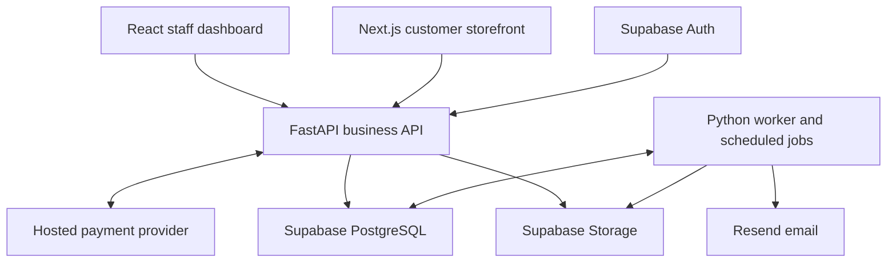

# Honor online stack plan

Date: 23 October 2026. Status: online architecture with a first local implementation. See DELIVERY_STATUS.md and RUNBOOK.md for implemented scope and verification. No production services or ML model have been deployed.

## Product boundary

Honor manages inventory for a business and exposes selected products through a customer storefront. Staff and online orders share one authoritative stock service. The company administers its staff, locations and approvals. Inventory remains the core; customer records, purchasing, payments and fulfilment support it.

The first release requires an Internet connection to confirm shared stock changes. An installed web app can provide a convenient entry point, but installation does not make disconnected stock writes safe. Offline selling requires a later allocation and reconciliation design.

## Recommended stack

| Layer                   | Choice                                                                                         | Reason and boundary                                                                                                                                                   |
| ----------------------- | ---------------------------------------------------------------------------------------------- | --------------------------------------------------------------------------------------------------------------------------------------------------------------------- |
| Staff dashboard         | Existing React, TypeScript, Vite and Tailwind CSS                                              | Preserve the Honor work and current inventory interface.                                                                                                              |
| Customer storefront     | Next.js, TypeScript and Tailwind CSS                                                           | Server-rendered product pages, product metadata and share previews. Use the same design tokens as the dashboard.                                                      |
| Frontend data           | TanStack Query for interactive API data; generated TypeScript API types                        | Refetch committed stock and invalidate affected queries after commands. Cached availability never authorises a sale.                                                  |
| Application backend     | Python, FastAPI and Pydantic                                                                   | One REST API owns inventory, orders, payments, company permissions and reporting. Python also supports the forecasting work.                                          |
| Database access         | SQLAlchemy, psycopg and Alembic migrations                                                     | Explicit PostgreSQL transactions and reproducible schema changes.                                                                                                     |
| Database                | PostgreSQL hosted on Supabase                                                                  | Relational stock, reservations, ledger, orders and audit records in one database. Supabase is the host, not an additional database.                                   |
| Identity                | Supabase Auth                                                                                  | Managed sign-in, password recovery and MFA; Honor implements company memberships and action/location permissions.                                                     |
| Files                   | Supabase Storage                                                                               | Approved public product images; private invoice, import and model-artifact buckets with scoped access.                                                                |
| Payments                | Hosted checkout through one provider adapter                                                   | Select the provider after confirming merchant country, eligibility, currency and settlement requirements. Paystack and Stripe are candidates, not active connections. |
| Email                   | Resend, including custom SMTP for Supabase Auth                                                | Invitations, password recovery, receipts and order updates. Verify a business sending domain before live use.                                                         |
| Background work         | Python worker with a PostgreSQL transactional outbox                                           | Persist work with the business transaction; claim with leases, retry with backoff, and expose failed jobs for review. Start without Redis.                            |
| Scheduled work          | Render Cron Jobs running the same Python codebase                                              | Reservation cleanup, reconciliation and scheduled forecasts. Check reservation expiry inside commands as well; cleanup timing is not a correctness guarantee.         |
| Forecasting             | pandas and scikit-learn                                                                        | Train and compare a demand-forecasting candidate with a simple baseline. Store predictions and model metadata separately from stock facts.                            |
| Hosting                 | Render for the staff dashboard/API together and Python jobs; Vercel for the Next.js storefront | Separate frontend builds while sharing one backend and database. Select compatible nearby service/database regions.                                                   |
| Delivery and monitoring | GitHub Actions, pytest, Playwright, structured logs and Sentry                                 | Migration/API/concurrency checks, browser purchase-flow checks, and actionable error monitoring.                                                                      |

Choose supported stable dependency releases when scaffolding and commit lockfiles. Keep the existing frontend version decisions separate from a future upgrade. Do not add a second Node business backend: Next.js handles storefront rendering and any necessary session bridge, while FastAPI owns business commands.

The tradeoff is two frontend applications to deploy. They use the same React/TypeScript ecosystem, and this avoids rewriting the existing dashboard while giving the public catalogue server-rendered pages.

## Connections and ownership

Keep company inventory tables in an unexposed schema, deny browser database writes, and use a restricted application database role. All stock writes pass through FastAPI. Configure grants and RLS for every exposed table; a privileged database connection does not automatically inherit end-user RLS protections. The API must enforce company, location and action scope itself.

FastAPI verifies token signature, issuer, audience and expiry, then checks current membership and session revocation on protected staff requests. Staff suspension and forced logout must take effect even while a previously issued JWT remains cryptographically valid. Use a server-checked session revocation record or active-session lookup. Require recent authentication and administrator MFA for privileged staff-access changes. Protect the last active company administrator.

Customer sign-up never creates a staff membership. Public catalogue responses expose approved products and selling prices, not internal costs, supplier records or IMEIs. Customer order reads require ownership or a short-lived, narrowly scoped checkout/order credential. Never authorise order access using only a guessable order number or email address.

Use an application connection pool sized against the Supabase connection budget across API and worker processes. Use a migration-capable connection for Alembic. Keep development and production data, credentials, buckets and payment modes separate.

## Stock-to-order workflow

1. Customer selects products. The backend resolves current prices, currency, tax/shipping rules and fulfilment location; it does not accept browser totals as authoritative.
2. In one database transaction, create the draft order and reserve available stock under row locks/constraints. In-store sales use the same availability rules. Store a reservation deadline and an idempotency key.
3. Initiate hosted checkout outside the stock transaction, using a durable payment attempt/reference. Recover interrupted attempts without creating duplicate orders or charges. Adding to a cart alone does not reserve stock.
4. Verify incoming payment-event signatures and durably save the event before acknowledging it. A worker verifies provider status and matches merchant account, order reference, amount and currency. Deduplicate events and payment transactions.
5. Apply payment and order transitions under transaction locks. A paid order keeps its stock allocation until fulfilment or an authorised cancellation. If payment arrives after the reservation expired, recheck stock; route unavailable orders to a visible exception/refund workflow. Never promise an unavailable unit.
6. Staff pick the order, record the actual serial unit where applicable and dispatch or mark collected. Record the physical stock issue once. Payment success alone is not physical dispatch.
7. Handle cancellation, refund and physical return separately. A refund does not prove an item was returned or is fit for resale. Reconcile provider transactions against payment records and inventory movements against balances.

Keep order, payment, reservation and fulfilment states separate. Record external notifications and failed jobs so support can investigate rather than silently lose work. Price and stock previews may be cached; checkout validation and stock mutation always use current authoritative state.

## First ML module

Start with daily demand forecasts per SKU and location for a defined future horizon. Candidate inputs are past daily sales, calendar features, historical prices/promotions and availability/stockout history. Supplier lead time, on-hand stock, existing reservations, incoming receipts and a configured safety policy turn the forecast into a replenishment suggestion.

An initial scikit-learn candidate is gradient boosting with historical lag features. Compare it against an appropriate simple baseline using chronological holdouts or rolling backtests. Record forecast horizon, MAE, uncertainty where supported, data coverage, model version and forecast timestamp. Use only information available at the forecast cutoff. Handle new products and intermittent demand explicitly; a model is not automatically better than a rule.

Sales observed while stock is unavailable do not measure all customer demand. Capture stockout periods and distinguish returns/cancellations from demand. Until business history is sufficient for credible evaluation, ship minimum-stock rules and label any prototype forecasts clearly. Do not present synthetic-data performance as validated company performance.

Run training and scheduled inference in a separate job process, never inside checkout. Save model artifacts in private storage because scheduled-job local disk is not durable. The dashboard reads stored forecasts through the API; forecast failure leaves purchasing and sales usable. A manager approves purchase suggestions.

A later open-source language model can explain forecasts and answer inventory questions through permission-scoped tools. Select its licence, hardware and hosting after testing actual tasks. Ollama on a development laptop is useful for experiments; it is not the production dependency for a customer checkout. An LLM does not control payment confirmation or authoritative stock quantities.

## Repository layout to implement

| Proposed path                         | Purpose                                                                             |
| ------------------------------------- | ----------------------------------------------------------------------------------- |
| `apps/dashboard/`                     | Move the existing Vite application when backend integration begins.                 |
| `apps/storefront/`                    | New Next.js customer application.                                                   |
| `services/backend/`                   | FastAPI application, SQLAlchemy models, Alembic migrations, jobs and backend tests. |
| `services/backend/honor/forecasting/` | Feature generation, baseline, training, inference and evaluation modules.           |
| `packages/api-client/`                | Generated TypeScript types/client from the FastAPI OpenAPI contract.                |
| `docs/`                               | Architecture decisions, API contracts and operational runbooks.                     |

The existing dashboard currently remains at the repository root in src/online; the Next.js app is in apps/storefront and the backend is in services/backend. Moving the dashboard into apps/dashboard and generating a shared API client remain future organisational work. Keep one repository and one modular backend codebase. API, worker and cron commands can deploy from the same backend source without becoming separate microservice implementations.

## Build order and acceptance gates

| Phase                      | Deliverable                                                                                                                      | Gate before continuing                                                                                                                                                   |
| -------------------------- | -------------------------------------------------------------------------------------------------------------------------------- | ------------------------------------------------------------------------------------------------------------------------------------------------------------------------ |
| 1. Shared stock foundation | Supabase resources, migrations, Auth, memberships, receipts, reservations, ledger and audit; connect the existing dashboard.     | Two devices see the same committed stock; last-unit concurrency succeeds once; replay creates no duplicate movement; suspended and cross-company users are denied.       |
| 2. Customer purchase       | Product publishing, storefront, cart, hosted checkout, verified payment processing, fulfilment, customer order access and email. | Sandbox checkout completes; duplicate/late events, wrong amounts, failed checkout, expired reservations and refunds behave correctly; costs and staff data stay private. |
| 3. Business pilot          | Real company configuration, opening-stock import, returns, stock counts, reporting, restore drill and operational alerts.        | Business staff complete receive → sell → fulfil → return/count; payment and stock reconciliation pass; backups restore successfully.                                     |
| 4. Forecasting             | Historical data pipeline, evaluated baseline/candidate, stored forecasts and reviewed replenishment suggestions.                 | Evaluate on unseen later periods and publish limitations; deploy the candidate only if it adds useful value over the baseline.                                           |
| 5. Optional assistant      | Selected open-source model with scoped inventory tools.                                                                          | Accurate answers with record references, enforced permissions and usable operation during model failure.                                                                 |

## Budget and open decisions

Plan for commercial hosting. Vercel Hobby is restricted to personal non-commercial use; choose a commercial plan for this business deployment. Render describes its free instances as unsuitable for production. Select database backup retention, capacity, mail allowances and monitoring retention before the pilot. No resources or subscriptions have been purchased.

Remaining inputs are the company's registration country, settlement currency, intended customer countries, expected locations/users/catalogue size, fulfilment and shipping rules, monthly operating budget, and any historical sales data. These determine payment eligibility, deployment region and resource sizing. They do not prevent building the shared stock foundation.

## Official references checked

- [Supabase Auth](https://supabase.com/docs/guides/auth) and [user/session management](https://supabase.com/docs/guides/auth/managing-user-data).
- [Supabase RLS and grants](https://supabase.com/docs/guides/database/postgres/row-level-security).
- [Supabase custom SMTP, including Resend](https://supabase.com/docs/guides/auth/auth-smtp).
- [SQLAlchemy transaction management](https://docs.sqlalchemy.org/en/20/orm/session_transaction.html).
- [Next.js metadata and product-page sharing](https://nextjs.org/docs/app/getting-started/metadata-and-og-images).
- [Paystack webhook verification](https://paystack.com/docs/payments/webhooks/) and [server-side transaction verification](https://paystack.com/docs/payments/verify-payments/).
- [FastAPI background-computation guidance](https://fastapi.tiangolo.com/tutorial/background-tasks/).
- [Render web services](https://render.com/docs/web-services), [cron jobs](https://render.com/docs/cronjobs) and [free-instance limitations](https://render.com/docs/free).
- [Vercel commercial-use plan boundary](https://vercel.com/docs/plans/hobby).
- [scikit-learn forecasting example and chronological evaluation](https://scikit-learn.org/stable/auto_examples/applications/plot_time_series_lagged_features.html).
